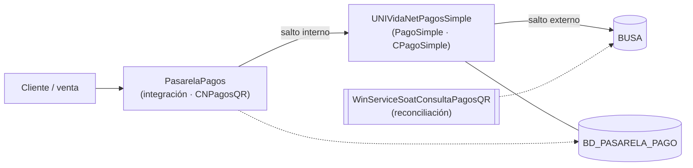

# Método de compensación idempotente con verificación de estado

> **Estado:** método formalizado. El paquete que sigue es el material de entrega para el
> walkthrough de aplicabilidad: el practicante recibe el método, no su implementación ni sus
> resultados.
>
> Documentos del paquete: `00_LEEME.md` (cómo usar el paquete), `02_decisiones.md`
> (Dc1–Dc13), `03_consulta_estado_qr.md` (contrato de la consulta de estado),
> `04_tablas_bitacora.md` (tablas disponibles) y `05_restricciones.md` (condiciones del
> entorno).

## 1. Identificación

- **Nombre del método:** Método de compensación idempotente con verificación de estado para Sagas sobre servicios externos no transaccionales.
- **Tipología:** método (con principios de diseño y criterios de verificación asociados).
- **Problema de diseño que resuelve:** ante un timeout o una respuesta perdida en cualquier salto de la cadena, el sistema actual no distingue una operación **no procesada** de una **procesada cuya respuesta se perdió**, y reintenta sin verificar; esto admite duplicados y deja operaciones sin estado final confiable.
- **Clase de problema y contexto:** integración **multi-salto** donde una cadena de servicios propios termina en un participante externo que no forma parte de la transacción global. La **clase** es «flujos con participantes externos no transaccionales»; el **exemplar** es la pasarela de pagos QR (`.NET/WCF`, sin mensajería) que encadena una capa de integración, un servicio de pago y el servicio externo BUSA.

### 1.1 Participantes y cadena de saltos

El problema no está en una sola llamada: recorre una **cadena**. Cada salto puede fallar a mitad, superar el tiempo de espera, perder la respuesta o duplicarse.

| Salto | Origen | Destino | Modos de fallo |
|:--|:--|:--|:--|
| Interno | Capa de integración (`CNPagosQR`) | Servicio de pago (`CPagoSimple`) | Timeout, respuesta perdida, solicitud duplicada |
| Externo | Servicio de pago (`CPagoSimple`) | BUSA (`_QR_001`, `_QR_003`) | Timeout, respuesta perdida, procesado sin confirmar |

**Consecuencia:** el método debe contemplar **todos los saltos** con **una sola identidad** de operación, y la compensación debe respetar el orden inverso de los saltos que sí se completaron. Las dos rutas de reintento hoy divergentes (RpcA en `CPagoSimple`, RpcB en `CNPagosQR`) son precisamente los dos puntos donde el problema se manifiesta.

## 2. Objetivo y alcance

- **Objetivo del método:** garantizar (a) la **idempotencia de la operación** y de la **compensación** en toda la cadena, y (b) la **resolución de los estados indeterminados**, de modo que ninguna operación quede con estado desconocido al cierre y ninguna compensación produzca efecto duplicado.
- **Principio rector:** el estado del servicio externo es la **fuente de verdad**, no la memoria del proceso. La bitácora propia acelera y ordena, pero ante cualquier ambigüedad se resuelve consultando al servicio externo.
- **Contexto de aplicación (precondiciones):**
  1. la operación tiene un **identificador estable y reproducible** (en este contexto, `TRAMITE_NUMERO` + `GESTION`), compartido por todos los saltos;
  2. el servicio externo **expone una operación de consulta de estado**;
  3. se dispone de un **almacén de bitácora** con una tabla de idempotencia de compensaciones identificada por `(operación, motivo)`;
  4. existe **unicidad en la base** sobre la llave lógica (índice único), como condición de la idempotencia (Dc10);
  5. el flujo cubre **todas las rutas de entrada** o declara y resuelve su divergencia (Dc11).
- **Qué queda fuera del alcance:**
  - la **reversión de pagos ya ejecutados** (BUSA no la ofrece, Dc8);
  - la **conciliación financiera con el banco** (proceso externo a la pasarela);
  - la introducción de una infraestructura de mensajería nueva.

## 3. Estructura

### 3.1 Roles y responsabilidades

| Rol | Responsabilidad | Perfil requerido |
|:--|:--|:--|
| Responsable de la integración | Implementa y opera el método; mantiene la bitácora y el índice único | Desarrollador con acceso al código de la cadena |
| Capa de integración (coordinador) | Coordina los saltos, decide y registra; aloja el motor de decisión (K4) | `PasarelaPagos` · `WebServicePasarelaPagos` (`CNPagosQR`) |
| Servicio de pago | Ejecuta la llamada al servicio externo y registra su paso | `UNIVidaNetPagosSimple` (`CPagoSimple`) |
| Servicio externo (BUSA) | Fuente de verdad del estado de la operación; expone la consulta | Interfaz de servicio disponible |
| Reconciliador | Recorre las operaciones huérfanas y hace converger su estado | Servicio programado existente (`WinServiceSoatConsultaPagosQR`) |
| Practicante independiente (revisión) | Recorre el método con un caso nuevo sin ayuda del autor | Revisor distinto del tesista (E7e, E8) |

### 3.2 Entradas y salidas

| Entrada | Fuente | Salida / producto de trabajo | Destino |
|:--|:--|:--|:--|
| Solicitud de operación | Usuario o proceso de negocio | Identidad de la operación `(TRAMITE_NUMERO, GESTION)` | Bitácora (K2) |
| Estado real de la operación | Consulta al servicio externo (K3) | Estado normalizado: procesado / no procesado / indeterminado | Motor de decisión (K4) |
| Regla de decisión | Método (sección 3.3) | Decisión: reprocesar / compensar / reconciliar | Ejecución o cola |
| Registro de compensación | Compensador (K5) | Par `(operación, motivo)` persistido | Tabla de idempotencia |
| Conjunto de operaciones huérfanas | Bitácora y reconciliador (K7) | Estado convergido por operación | Bitácora |
| Evidencia de ejecución | Telemetría (K9) | Registro: intento, causa, resultado y **salto** | Bitácora, recuperable por operación |

### 3.3 Pasos

| N.º | Actividad | Rol responsable | Entradas | Producto | Criterio de salida |
|:--|:--|:--|:--|:--|:--|
| 1 | Asignar la identidad determinista de la operación (única para toda la cadena) | Coordinador | `TRAMITE_NUMERO`, `GESTION` | Llave de idempotencia (K1) | La misma operación produce siempre la misma llave, en cualquier salto |
| 2 | Registrar el estado inicial en la bitácora | Coordinador | Llave | Fila de operación con estado inicial (K2) | Registro previo a la llamada externa |
| 3 | Ejecutar la operación a través de la cadena (integración → servicio de pago → servicio externo) | Servicio de pago (coordinado) | Llave, datos de la operación | Respuesta o excepción por salto | Se conoce el desenlace de cada salto |
| 4 | Si hay respuesta de éxito: registrar "procesada" | Coordinador | Respuesta | Estado final de la operación | Estado confirmado por el servicio |
| 5 | Si hay error de negocio (`0003`/`0004`): reintentar con reglas y telemetría | Coordinador | Código de error | Reintento controlado (K4, K9) | Reintento con causa y número de intento registrados |
| 6 | Si hay timeout o respuesta perdida en cualquier salto: consultar el estado real | Coordinador | Llave | Estado consultado (K3) | Se conoce el estado o se marca indeterminado |
| 7 | Normalizar el estado consultado | Coordinador | Respuesta de la consulta | Categoría: procesado / no procesado / indeterminado | Mapeo según la tabla de la sección 3.4 |
| 8 | Decidir la acción | Coordinador | Categoría del estado | Reprocesar / compensar / reconciliar (K4) | Decisión determinista y trazable |
| 9 | Si el estado es indeterminado (PENDIENTE): reconsultar dentro de la ventana | Coordinador | Marca de tiempo | Reconsulta registrada | No se asume estado; se reconsulta hasta 20 minutos |
| 10 | Superada la ventana: enviar a reconciliación | Reconciliador | Operación fuera de ventana | Operación en cola (K7) | La operación pasa a la reconciliación |
| 11 | Compensar de forma idempotente y ordenada | Coordinador | Decisión "compensar" | Compensación por `(operación, motivo)` (K5, K6) | Una sola compensación efectiva por par, en orden inverso a los saltos completados |
| 12 | Reconciliar las operaciones huérfanas | Reconciliador | Conjunto de huérfanas | Estado convergido (K7) | Cero operaciones sin estado final al cierre |
| 13 | Verificar idempotencia y consistencia | Coordinador / verificador | Estado final | Aserciones satisfechas (K8) | Sin efecto duplicado ni eslabón huérfano |
| 14 | Registrar la telemetría (incluido el salto) | Coordinador | Intento, causa, resultado, salto | Registro recuperable por operación (K9) | Registro disponible y consultable |

**Nota multi-salto:** los pasos 3–7 se ejecutan **por salto**; el paso 3 recorre la cadena. La verificación de estado (paso 6) consulta **siempre al servicio externo**, porque los saltos internos no conocen el resultado final. La compensación (paso 11) aplica en **orden inverso** a los saltos que sí se completaron (K6).

### 3.4 Regla de normalización del estado

| Estado en el servicio externo | Categoría | Acción |
|:--|:--|:--|
| PAGADO / EJECUTADO | procesado | No compensar; disparar el paso siguiente de forma idempotente |
| SOLICITADO / ANULADO / VENCIDO | no procesado | Habilitar el reproceso; verificar consistencia de una anulación previa |
| PENDIENTE (dentro de 20 min) | indeterminado | Reconsultar; no asumir |
| PENDIENTE (fuera de 20 min) | indeterminado | Reconciliar; mantener en cola con alerta si persiste |

### 3.5 Coordinación multi-salto (decisión adoptada)

El método necesita un **único punto** que decida y registre. Opciones consideradas:

| Opción | Descripción | Ventajas | Costos / riesgos |
|:--|:--|:--|:--|
| **A. Coordinador en la capa de integración** | La integración (`PasarelaPagos`) mantiene la bitácora, decide (K4) y ordena las compensaciones (K6) de los dos saltos | Un solo punto de decisión; los servicios de abajo quedan como ejecución | La integración debe conocer el estado real del servicio externo (vía consulta) |
| **B. Método por salto con identidad y bitácora compartidas** | Cada servicio registra su paso y aplica verificación y compensación idempotente sobre su parte | Menos acoplamiento; escalable a más saltos | Dos puntos de decisión; exige coordinar la identidad y el orden de compensación |

En ambos casos: **una sola llave** (K1) para toda la cadena y **una sola fuente de verdad** del estado final (el servicio externo).

**Decisión adoptada (2026-10-13): Opción A.** El coordinador vive en la **capa de integración** (`PasarelaPagos`), que mantiene la bitácora, decide (K4) y ordena las compensaciones (K6) de los dos saltos. El servicio de pago (`UNIVidaNetPagosSimple`) queda como ejecución del salto externo y registra su paso.

Consecuencias:

- K4 y K6 se implementan en la capa de integración.
- La capa de integración consulta el estado real en BUSA (K3) antes de decidir.
- La alternativa B se descarta por duplicar puntos de decisión; se conserva como referencia.

### 3.6 Relación con los componentes

| Componente | Tipo | Función en el método | Requisito |
|:--|:--|:--|:--|
| K1 Generador de identidad | constructo | Deriva la llave de idempotencia | F1 |
| K2 Bitácora de estado | método | Registra estado de operación, de cada salto y de la compensación | F2, F5 |
| K3 Verificador de estado | método | Consulta y normaliza el estado externo | F3 |
| K4 Motor de decisión | método | Decide reprocesar / compensar / reconciliar | F4 |
| K5 Compensador idempotente | método | Compensa por `(operación, motivo)` sin efecto repetido | F5 |
| K6 Ordenador de compensaciones | método | Aplica orden inverso y dependencias entre saltos | F6 |
| K7 Reconciliador | método | Resuelve operaciones indeterminadas (idempotente) | F7 |
| K8 Verificador de idempotencia | método | Escenarios y aserciones de la propiedad | F8 |
| K9 Telemetría de intentos | método | Registra intento, causa, resultado y salto | F9 |

## 4. Fundamentación teórica

- La estructura de operación y compensación proviene de las Sagas (R1, García-Molina y Salem).
- La regla "el estado externo es la fuente de verdad" y la deduplicación se apoyan en Helland (R2).
- La reconciliación de los indeterminados se apoya en la consistencia eventual (R3, Vogels).
- La verificación de la idempotencia se apoya en Hummer et al. (R4) y en la inyección de fallos de Basiri et al. (R6).
- El registro del estado de la saga se apoya en Daraghmi et al. (R10).

## 5. Decisiones de diseño (referencia)

Se conservan las decisiones Dc1–Dc13 y los refinamientos Dc10–Dc12 documentados en `07c_diseno_artefacto.md`. Las que condicionan la aplicación del método:

| Decisión | Contenido | Consecuencia operativa |
|:--|:--|:--|
| Dc1 | Llave derivada de `(TRAMITE_NUMERO, GESTION)` | No requiere persistir un identificador nuevo; debe compartirse entre saltos |
| Dc2 | Verificar el estado ante sospecha, no siempre | Menor latencia en el camino exitoso |
| Dc3 | PENDIENTE = indeterminado; reconsultar y luego reconciliar | Prohíbe asumir el estado |
| Dc5 | Compensación por `(operación, motivo)` con registro previo | Hace reconocible la repetición |
| Dc8 | Solo se compensa la anulación del QR no pagado | No hay reversión de pago |
| Dc10 | Índice único sobre la llave lógica | Condición necesaria de la idempotencia |
| Dc11 | Cubrir RpcA y RpcB | Resuelve la divergencia de reintentos entre los dos saltos |
| Dc12 | Reconciliación con el servicio de convergencia existente | No se introduce infraestructura nueva |

## 6. Guía de aplicación

- **Instrumentos y plantillas de apoyo:** bitácora de estado (por operación y por salto), tabla de idempotencia de compensaciones `(operación, motivo)`, registro de telemetría (intento, causa, resultado, salto).
- **Variantes según contexto:** si el servicio externo no expone consulta de estado, el método no aplica y la operación queda como indeterminada (se declara como condición de contorno); si hay varias rutas de entrada, todas deben invocar el mismo verificador y la misma bitácora; si la cadena tiene más saltos, la identidad y el orden de compensación deben propagarse.
- **Errores frecuentes de aplicación y cómo evitarlos:**
  1. asumir el estado ante PENDIENTE (evitar: reconsultar siempre dentro de la ventana);
  2. compensar sin registrar `(operación, motivo)` (evitar: registrar antes de ejecutar);
  3. confiar en la memoria del proceso como fuente de verdad (evitar: consultar al servicio externo);
  4. omitir el índice único en la base (evitar: crearlo antes de confiar en la idempotencia);
  5. usar identidades distintas por salto (evitar: una sola llave para toda la cadena).

## 7. Verificación

La verificación de consistencia interna del método se realiza sobre la matriz
paso ↔ requisito ↔ componente ↔ comprobación. Los resultados de esa verificación **no forman
parte de este documento**: el practicante recibe el método, no sus resultados.

- **Walkthrough de aplicabilidad:** se realiza con un practicante independiente, sobre un caso
  nuevo. El guion y los materiales están en este mismo paquete.
- **Matriz de consistencia:** disponible por separado.

## 8. Exemplar de aplicación

- **Caso donde se aplicó:** cadena de pagos QR sobre el servicio BUSA
  (`PasarelaPagos` → `UNIVidaNetPagosSimple` → BUSA), en entorno aislado, sobre un servicio
  externo simulado que **no es idempotente por defecto**, y con datos sintéticos.
- **Limitaciones observadas:** el servicio simulado no es BUSA real, de modo que no acredita el
  comportamiento del servicio real; no se cubre la reversión de pagos ya ejecutados.

## 9. Limitaciones conocidas

- No contempla la reversión de un pago ya ejecutado (BUSA no la ofrece).
- No cubre la conciliación financiera con el banco.
- Su garantía de idempotencia depende de que el servicio externo permita verificar el estado y de la unicidad en la base.
- La evidencia se produce sobre un doble; no acredita el comportamiento del servicio real.
- La cadena puede tener más de dos saltos; el método se describe para dos, pero exige propagación de identidad y orden.
