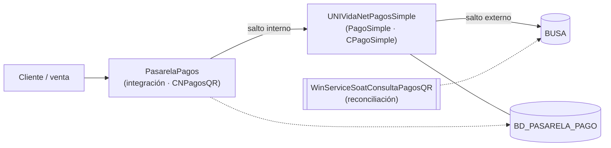

# Método de compensación idempotente con verificación de estado

> **Estado:** construcción y verificación técnica **ejecutadas** (V1–V8 cumplen; ver sección 7) y walkthrough independiente **cumplido** (2026-10-16, informe 2026-10-20). La evidencia verifica el método, **no su despliegue** (ver secciones 8 y 9). Versión congelada: SHA-256 `ec9b8b6e…` (43.520 bytes).
>
> Archivo de la etapa: `07e_construccion_verificacion.md`. Diseño de referencia: `07c_diseno_artefacto.md`. Requisitos: `07b_requisitos.md`. Plan y versiones: `07d_plan_construccion.md`.

## 1. Identificación

- **Nombre del método:** Método de compensación idempotente con verificación de estado para Sagas sobre servicios externos no transaccionales.
- **Tipología:** método (con principios de diseño y criterios de verificación asociados).
- **Problema de diseño que resuelve:** ante un timeout o una respuesta perdida en cualquier salto de la cadena, el sistema actual no distingue una operación **no procesada** de una **procesada cuya respuesta se perdió**, y reintenta sin verificar; esto admite duplicados y deja operaciones sin estado final confiable.
- **Clase de problema y contexto:** integración **multi-salto** donde una cadena de servicios propios termina en un participante externo que no forma parte de la transacción global. La **clase** es «flujos con participantes externos no transaccionales»; el **exemplar** es la pasarela de pagos QR (`.NET/WCF`, sin mensajería) que encadena una capa de integración, un servicio de pago y el servicio externo BUSA.

### 1.1 Participantes y cadena de saltos

El problema no está en una sola llamada: recorre una **cadena**. Cada salto puede fallar a mitad, superar el tiempo de espera, perder la respuesta o duplicarse.

| Salto | Origen | Destino | Modos de fallo |
|:--|:--|:--|:--|
| Interno | Capa de integración (`CNPagosQR`) | Servicio de pago (`CPagoSimple`) | Timeout, respuesta perdida, solicitud duplicada |
| Externo | Servicio de pago (`CPagoSimple`) | BUSA (`_QR_001`, `_QR_003`) | Timeout, respuesta perdida, procesado sin confirmar |

**Consecuencia:** el método debe contemplar **todos los saltos** con **una sola identidad** de operación, y la compensación debe respetar el orden inverso de los saltos que sí se completaron. Las dos rutas de reintento hoy divergentes (RpcA en `CPagoSimple`, RpcB en `CNPagosQR`) son precisamente los dos puntos donde el problema se manifiesta.

## 2. Objetivo y alcance

- **Objetivo del método:** garantizar (a) la **idempotencia de la operación** y de la **compensación** en toda la cadena, y (b) la **resolución de los estados indeterminados**, de modo que ninguna operación quede con estado desconocido al cierre y ninguna compensación produzca efecto duplicado.
- **Principio rector:** el estado del servicio externo es la **fuente de verdad**, no la memoria del proceso. La bitácora propia acelera y ordena, pero ante cualquier ambigüedad se resuelve consultando al servicio externo.
- **Contexto de aplicación (precondiciones):**
  1. la operación tiene un **identificador estable y reproducible**: `(TRAMITE_SECUENCIAL, T_PAR_SIMPLE_TRAMITE_FK)` en `PAGO_SIMPLE.T_QR_SOLICITUD`, compartido por todos los saltos. La segunda columna es el **canal/tipo de trámite**, no el año; su unicidad es una condición de despliegue (Dc10);
  2. el servicio externo **expone una operación de consulta de estado**;
  3. se dispone de un **almacén de bitácora** con una tabla de idempotencia de compensaciones identificada por `(operación, motivo)`;
  4. existe **unicidad en la base** sobre la llave lógica (índice único), como condición de la idempotencia (Dc10);
  5. el flujo cubre **todas las rutas de entrada** o declara y resuelve su divergencia (Dc11).
- **Qué queda fuera del alcance:**
  - la **reversión de pagos ya ejecutados** (BUSA no la ofrece, Dc8);
  - la **conciliación financiera con el banco** (proceso externo a la pasarela);
  - la introducción de una infraestructura de mensajería nueva.

## 3. Estructura

### 3.1 Roles y responsabilidades

| Rol | Responsabilidad | Perfil requerido |
|:--|:--|:--|
| Responsable de la integración | Implementa y opera el método; mantiene la bitácora y el índice único | Desarrollador con acceso al código de la cadena |
| Capa de integración (coordinador) | Coordina los saltos, decide y registra; aloja el motor de decisión (K4) | `PasarelaPagos` · `WebServicePasarelaPagos` (`CNPagosQR`) |
| Servicio de pago | Ejecuta la llamada al servicio externo y registra su paso | `UNIVidaNetPagosSimple` (`CPagoSimple`) |
| Servicio externo (BUSA) | Fuente de verdad del estado de la operación; expone la consulta | Interfaz de servicio disponible |
| Reconciliador | Recorre las operaciones huérfanas y hace converger su estado | Servicio programado existente (`WinServiceSoatConsultaPagosQR`) |
| Practicante independiente (revisión) | Recorre el método con un caso nuevo sin ayuda del autor | Revisor distinto del tesista (E7e, E8) |

### 3.2 Entradas y salidas

| Entrada | Fuente | Salida / producto de trabajo | Destino |
|:--|:--|:--|:--|
| Solicitud de operación | Usuario o proceso de negocio | Identidad de la operación `(TRAMITE_SECUENCIAL, T_PAR_SIMPLE_TRAMITE_FK)` | Bitácora (K2) |
| Estado real de la operación | Consulta al servicio externo (K3) | Estado normalizado: procesado / no procesado / indeterminado | Motor de decisión (K4) |
| Regla de decisión | Método (sección 3.3) | Decisión: reprocesar / compensar / reconciliar | Ejecución o cola |
| Registro de compensación | Compensador (K5) | Par `(operación, motivo)` persistido | Tabla de idempotencia |
| Conjunto de operaciones huérfanas | Bitácora y reconciliador (K7) | Estado convergido por operación | Bitácora |
| Evidencia de ejecución | Telemetría (K9) | Registro: intento, causa, resultado y **salto** | Bitácora, recuperable por operación |

### 3.3 Pasos

| N.º | Actividad | Rol responsable | Entradas | Producto | Criterio de salida |
|:--|:--|:--|:--|:--|:--|
| 1 | Asignar la identidad determinista de la operación (única para toda la cadena) | Coordinador | `TRAMITE_SECUENCIAL`, `T_PAR_SIMPLE_TRAMITE_FK` | Llave de idempotencia (K1) | La misma operación produce siempre la misma llave, en cualquier salto |
| 2 | Registrar el estado inicial en la bitácora | Coordinador | Llave | Fila de operación con estado inicial (K2) | Registro previo a la llamada externa |
| 3 | Ejecutar la operación a través de la cadena (integración → servicio de pago → servicio externo) | Servicio de pago (coordinado) | Llave, datos de la operación | Respuesta o excepción por salto | Se conoce el desenlace de cada salto |
| 4 | Si hay respuesta de éxito: registrar "procesada" | Coordinador | Respuesta | Estado final de la operación | Estado confirmado por el servicio |
| 5 | Si hay error de negocio (`0003`/`0004`): reintentar con reglas y telemetría | Coordinador | Código de error | Reintento controlado (K4, K9) | Reintento con causa y número de intento registrados |
| 6 | Si hay timeout o respuesta perdida en cualquier salto: consultar el estado real | Coordinador | Llave | Estado consultado (K3) | Se conoce el estado o se marca indeterminado |
| 7 | Normalizar el estado consultado | Coordinador | Respuesta de la consulta | Categoría: procesado / no procesado / indeterminado | Mapeo según la tabla de la sección 3.4 |
| 8 | Decidir la acción | Coordinador | Categoría del estado | Reprocesar / compensar / reconciliar (K4) | Decisión determinista y trazable |
| 9 | Si el estado es indeterminado (`INDETERMINADO` / `PENDIENTE_RESOLUCION`): reconsultar dentro de la ventana | Coordinador | Marca de tiempo | Reconsulta registrada | No se asume estado; se reconsulta hasta 20 minutos |
| 10 | Superada la ventana: enviar a reconciliación | Reconciliador | Operación fuera de ventana | Operación en cola (K7) | La operación pasa a la reconciliación |
| 11 | Compensar de forma idempotente y ordenada | Coordinador | Decisión "compensar" | Compensación por `(operación, motivo)` (K5, K6) | Una sola compensación efectiva por par, en orden inverso a los saltos completados |
| 12 | Reconciliar las operaciones huérfanas | Reconciliador | Conjunto de huérfanas | Estado convergido (K7) | Cero operaciones sin estado final al cierre |
| 13 | Verificar idempotencia y consistencia | Coordinador / verificador | Estado final | Aserciones satisfechas (K8) | Sin efecto duplicado ni eslabón huérfano |
| 14 | Registrar la telemetría (incluido el salto) | Coordinador | Intento, causa, resultado, salto | Registro recuperable por operación (K9) | Registro disponible y consultable |

**Nota multi-salto:** los pasos 3–7 se ejecutan **por salto**; el paso 3 recorre la cadena. La verificación de estado (paso 6) consulta **siempre al servicio externo**, porque los saltos internos no conocen el resultado final. La compensación (paso 11) aplica en **orden inverso** a los saltos que sí se completaron (K6).

### 3.4 Regla de normalización del estado

| Estado en el servicio externo | Categoría | Acción |
|:--|:--|:--|
| PAGADO / EJECUTADO | procesado | No compensar; disparar el paso siguiente de forma idempotente |
| SOLICITADO / ANULADO / VENCIDO | no procesado | Habilitar el reproceso; verificar consistencia de una anulación previa |
| INDETERMINADO / `PENDIENTE_RESOLUCION` (dentro de 20 min) | indeterminado | Reconsultar; no asumir |
| INDETERMINADO / `PENDIENTE_RESOLUCION` (fuera de 20 min) | indeterminado | Reconciliar; mantener en cola con alerta si persiste |

> `PENDIENTE` es una categoría **sintética del método**, no un código que devuelva BUSA (que responde `H`, `P`, `A`, `V`). Se renombra a `INDETERMINADO` para evitar que quien implemente busque ese literal en la respuesta del servicio.

> La ventana se mide en **minutos completos**: no distingue 19:59 de 20:01. Es una condición de contorno declarada en el ciclo formativo.

**Límite de la normalización (Dc14).** La categoría de negocio es necesaria pero **no suficiente**: un estado `SOLICITADO` no dice si el efecto ya ocurrió. Por eso K3 consulta además la cantidad de recursos del externo y K4 decide con **dos hechos**: la categoría y la existencia del recurso.

### 3.5 Coordinación multi-salto (decisión adoptada)

El método necesita un **único punto** que decida y registre. Opciones consideradas:

| Opción | Descripción | Ventajas | Costos / riesgos |
|:--|:--|:--|:--|
| **A. Coordinador en la capa de integración** | La integración (`PasarelaPagos`) mantiene la bitácora, decide (K4) y ordena las compensaciones (K6) de los dos saltos | Un solo punto de decisión; los servicios de abajo quedan como ejecución | La integración debe conocer el estado real del servicio externo (vía consulta) |
| **B. Método por salto con identidad y bitácora compartidas** | Cada servicio registra su paso y aplica verificación y compensación idempotente sobre su parte | Menos acoplamiento; escalable a más saltos | Dos puntos de decisión; exige coordinar la identidad y el orden de compensación |

En ambos casos: **una sola llave** (K1) para toda la cadena y **una sola fuente de verdad** del estado final (el servicio externo).

**Decisión adoptada (2026-10-13): Opción A.** El coordinador vive en la **capa de integración** (`PasarelaPagos`), que mantiene la bitácora, decide (K4) y ordena las compensaciones (K6) de los dos saltos. El servicio de pago (`UNIVidaNetPagosSimple`) queda como ejecución del salto externo y registra su paso.

Consecuencias:

- K4 y K6 se implementan en la capa de integración.
- La capa de integración consulta el estado real en BUSA (K3) antes de decidir.
- La alternativa B se descarta por duplicar puntos de decisión; se conserva como referencia.

### 3.6 Relación con los componentes

| Componente | Tipo | Función en el método | Requisito |
|:--|:--|:--|:--|
| K1 Generador de identidad | constructo | Deriva la llave de idempotencia | F1 |
| K2 Bitácora de estado | método | Registra estado de operación, de cada salto y de la compensación | F2, F5 |
| K3 Verificador de estado | método | Consulta el estado **y la cantidad de recursos** del externo; normaliza y expone `RecursoExiste` | F3 |
| K4 Motor de decisión | método | Decide con **dos hechos** (categoría de negocio + existencia del recurso) entre reprocesar / compensar / reconciliar | F4 |
| K5 Compensador idempotente | método | Compensa por `(operación, motivo)` sin efecto repetido | F5 |
| K6 Ordenador de compensaciones | método | Aplica orden inverso y dependencias entre saltos | F6 |
| K7 Reconciliador | método | Resuelve operaciones indeterminadas (idempotente) | F7 |
| K8 Verificador de idempotencia | método | Escenarios y aserciones de la propiedad | F8 |
| K9 Telemetría de intentos | método | Registra intento, causa, resultado y salto | F9 |

## 4. Fundamentación teórica

- La estructura de operación y compensación proviene de las Sagas (R1, García-Molina y Salem).
- La regla "el estado externo es la fuente de verdad" y la deduplicación se apoyan en Helland (R2).
- La reconciliación de los indeterminados se apoya en la consistencia eventual (R3, Vogels).
- La verificación de la idempotencia se apoya en Hummer et al. (R4) y en la inyección de fallos de Basiri et al. (R6).
- El registro del estado de la saga se apoya en Daraghmi et al. (R10).

## 5. Decisiones de diseño (referencia)

Se conservan las decisiones Dc1–Dc13 y los refinamientos Dc10–Dc12 documentados en `07c_diseno_artefacto.md`. Las que condicionan la aplicación del método:

| Decisión | Contenido | Consecuencia operativa |
|:--|:--|:--|
| Dc1 | Llave derivada de `(TRAMITE_SECUENCIAL, T_PAR_SIMPLE_TRAMITE_FK)` | No requiere persistir un identificador nuevo; debe compartirse entre saltos. `GESTION` no es el año: es el canal; la unicidad depende de Dc10 |
| Dc2 | Verificar el estado ante sospecha, no siempre | Menor latencia en el camino exitoso |
| Dc3 | INDETERMINADO (`PENDIENTE_RESOLUCION`) = no asumir; reconsultar y luego reconciliar | Prohíbe asumir el estado |
| Dc5 | Compensación por `(operación, motivo)` con registro previo | Hace reconocible la repetición |
| Dc8 | Solo se compensa la anulación del QR no pagado | No hay reversión de pago |
| Dc10 | Índice único sobre la llave lógica | Condición necesaria de la idempotencia |
| Dc11 | Cubrir RpcA y RpcB | Resuelve la divergencia de reintentos entre los dos saltos |
| Dc12 | Reconciliación con el servicio de convergencia existente | No se introduce infraestructura nueva |
| Dc14 | **Decidir con dos hechos**: la categoría de negocio **y** la existencia del recurso en el externo (K3 consulta `UnidadesQr`) | Evita el `Reprocesar` ciego cuando el efecto ya ocurrió |

**Dc14 — decisión con dos hechos (extensión de K3/K4).** El diseño original decidía solo con la categoría de negocio normalizada del estado externo. La ejecución de **V1** (escenarios 2 y 3) mostró que un estado `SOLICITADO` **no informa** si el efecto ya ocurrió: en ambos el recurso externo ya existía, y decidir solo por categoría habría producido `Reprocesar` y un segundo recurso.

- **Alternativa considerada:** decidir solo con la categoría de negocio (`SOLICITADO` → no procesado → reprocesar).
- **Por qué se descarta:** produce duplicado cuando el efecto ya ocurrió.
- **Origen:** no es una racionalización a posteriori; fue una **comprobación** (V1, escenarios 2 y 3) la que reveló la insuficiencia y forzó el cambio. Queda en el registro de cambios como cambio de V1.

## 6. Guía de aplicación

- **Instrumentos y plantillas de apoyo:** bitácora de estado (por operación y por salto), tabla de idempotencia de compensaciones `(operación, motivo)`, registro de telemetría (intento, causa, resultado, salto).
- **Variantes según contexto:** si el servicio externo no expone consulta de estado, el método no aplica y la operación queda como indeterminada (se declara como condición de contorno); si hay varias rutas de entrada, todas deben invocar el mismo verificador y la misma bitácora; si la cadena tiene más saltos, la identidad y el orden de compensación deben propagarse.
- **Errores frecuentes de aplicación y cómo evitarlos:**
  1. asumir el estado ante INDETERMINADO (evitar: reconsultar siempre dentro de la ventana);
  2. compensar sin registrar `(operación, motivo)` (evitar: registrar antes de ejecutar);
  3. confiar en la memoria del proceso como fuente de verdad (evitar: consultar al servicio externo);
  4. omitir el índice único en la base (evitar: crearlo antes de confiar en la idempotencia);
  5. usar identidades distintas por salto (evitar: una sola llave para toda la cadena).

> **Reserva-Ejecución-Confirmación (advertencia).** En una compensación, primero se registra la intención en la tabla de idempotencia (estado `Registrada`), luego se ejecuta la acción externa y solo después se marca `Aplicada`. Registrar **después** de ejecutar destruye la idempotencia: si el proceso muere entre el efecto y el registro, la repetición no se reconoce. El DDL de la tabla y del índice único está en `e7e-testbed/.../Sql/01_tabla_idempotencia_compensaciones.sql`.

## 7. Verificación interna (E7e)

**Ejecutada** el 2026-10-13 (evidencia generada el 2026-10-14). Se construyó el artefacto `E7e_MetodoCompensacion` (`netstandard2.0`, sin dependencias fuera de la BCL) y se ejecutaron las ocho comprobaciones contra un **doble neutro** (`busa-eval-stub`, HTTP en `localhost:5098`, datos sintéticos), con el **control negativo** confirmado. El detalle está en `07e_construccion_verificacion.md` y en `evidencia_e7e/`.

| # | Comprobación | Crítica | Resultado |
|:--|:--|:--|:--|
| V1 | K3 distingue procesado / no procesado / indeterminado | — | **CUMPLE** |
| V2 | Repetir la compensación deja el estado final idéntico (N = 1, 2, 5, 10) | **Sí** | **CUMPLE** — 1 sola compensación efectiva |
| V3 | No se compensa dos veces una operación ya compensada | **Sí** | **CUMPLE** — 10 invocaciones → 1 efecto; 0 pares duplicados |
| V4 | El PENDIENTE se respeta durante la ventana de 20 min | — | **CUMPLE** — reconsultar; no asume |
| V5 | La reconciliación es idempotente | — | **CUMPLE** — 2.ª corrida sin efectos nuevos |
| V6 | La telemetría registra intento, causa y resultado | — | **CUMPLE** — 3 de 3 eventos completos y con salto (fuente: `evidencia_e7e/v2_resultados.md`) |
| V7 | Sin espera bloqueante en el camino crítico | — | **CUMPLE** (inspección: sin `Thread.Sleep` / `.Wait` / `.Result`) |
| V8 | Consistencia interna, sin huérfanos | — | **CUMPLE** — 0 requisitos sin componente |

**Control negativo (neutralidad del doble):** confirmado. Sin K5, N invocaciones producen N efectos; con K5, siempre uno.

| N | Sin K5 | Con K5 |
|:--|:--|:--|
| 1 | 1 | 1 |
| 2 | 2 | 1 |
| 5 | 5 | 1 |
| 10 | 10 | 1 |

**Extensión del método hallada en V1.** La normalización solo por estado resultó insuficiente: en los escenarios 2 y 3 el estado es `SOLICITADO` **y el recurso ya existe** (el externo aplicó el efecto antes de cortar la respuesta). Por eso K3 consulta además cuántos recursos tiene el externo (`UnidadesQr`) y K4 decide con **dos hechos**: categoría de negocio + existencia del recurso. Es una extensión del **método**, no del doble, registrada como cambio de V1.

**Revisión por expertos:**

- **Walkthrough con practicante independiente: cumplido** (2026-10-16; informe 2026-10-20; 6/8 tareas y 0/2 puntos críticos a la primera). Los tres cambios derivados se aplicaron al método (INDETERMINADO, mapeo lógico↔físico, Reserva-Ejecución-Confirmación). Se sumó una segunda hoja de aplicabilidad (2026-10-20) que no sustituye un ciclo de evaluación.
- Revisión experta (Senior .NET / Sagas): pendiente.

**Trazabilidad:** artefacto ejecutado el 2026-10-13; versión congelada el 2026-10-27; SHA-256 `ec9b8b6e8d37374ff28f2eb816285571ede997c47ec44a235da829d13dbd10bf`; doble `busa-eval-stub` en `http://localhost:5098`.

## 8. Exemplar de aplicación

- **Caso donde se aplicó:** cadena de pagos QR sobre el servicio BUSA, con el artefacto `E7e_MetodoCompensacion` ejecutado contra un **doble neutro** (`busa-eval-stub`) y datos sintéticos, en entorno aislado.
- **Evidencia producida:** V1–V8 **CUMPLE**; **control negativo confirmado** (la garantía proviene de K5, no del doble); registro de cambios con 9 cambios y 8 defectos detectados por ejecución (4 del artefacto, 4 del banco de pruebas).
- **Limitaciones observadas:** **la evidencia verifica el método, no su despliegue.** La integración es **parcial**:
  - la **cadena completa no se ejecutó**; los dos saltos son adaptadores (`InyectorSaltoInterno`, `ServicioExternoHttp`), no `CNPagosQR` ni `CPagoSimple`;
  - el **DDL de Dc10 no se aplicó** (queda pendiente por los 44 duplicados de E6) y la tabla de idempotencia no existe en ninguna base;
  - los **adaptadores reales no se escribieron** (WCF para el externo, `T_QR_SOLICITUD` para la bitácora);
  - el cliente WCF real de BUSA **enlaza con el doble** (2/2), pero el servicio real no se invocó;
  - El doble no es BUSA real; no se cubre la reversión de pagos ya ejecutados.

## 9. Limitaciones conocidas

- **La evidencia verifica el método, no su despliegue.** La integración con la cadena real está pendiente: la cadena completa no se ejecutó, el DDL de Dc10 no se aplicó y los adaptadores reales (WCF para el externo, `T_QR_SOLICITUD` para la bitácora) no se escribieron.
- **La concurrencia se verificó en una instancia.** El lock es de proceso; la garantía distribuida depende de Dc10 (índice único e inserción atómica) y no está demostrada.
- No contempla la reversión de un pago ya ejecutado (BUSA no la ofrece).
- No cubre la conciliación financiera con el banco.
- Su garantía de idempotencia depende de que el servicio externo permita verificar el estado y de la unicidad en la base.
- La evidencia se produce sobre un doble; no acredita el comportamiento del servicio real.
- La cadena puede tener más de dos saltos; el método se describe para dos, pero exige propagación de identidad y orden.
