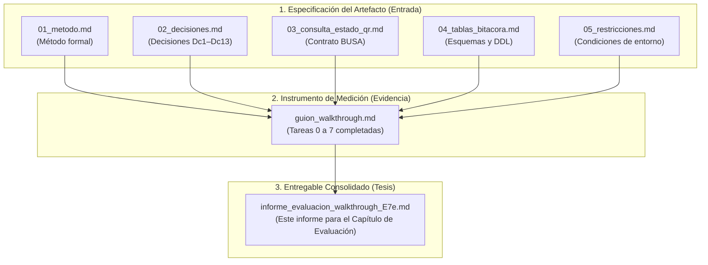

# Informe de Evaluación de Aplicabilidad del Método (Etapa E7e)
**Evaluación Empírica mediante Walkthrough Independiente**

| Campo | Valor |
|---|---|
| **Proyecto / Tesis** | Método de compensación idempotente con verificación de estado para Sagas sobre servicios externos no transaccionales |
| **Etapa de Investigación** | E7e (Evaluación de aplicabilidad del artefacto / método) |
| **Fecha de Ejecución** | 2026-10-20 |
| **Rol Evaluador** | Desarrollador Junior (Evaluador independiente) |
| **Entorno de Evaluación** | Aislado (`sad-desa` / `BD_PASARELA_PAGO`) |
| **Caso Asignado** | Venta SOAT real: `TRAMITE_SECUENCIAL = 3147`, Gestión 2026 (`T_PAR_SIMPLE_TRAMITE_FK = 3`) |
| **Tipo de Falla** | Corte de red tras aplicación de efecto en servicio externo BUSA |

---

## 1. Introducción y Propósito

En el marco metodológico de Design Science Research (DSR), un artefacto (en este caso, un **método de diseño**) no solo debe funcionar en manos de su autor, sino que debe demostrar **transferibilidad, rigurosidad y aplicabilidad** por parte de terceros sin asistencia directa del investigador.

Este informe consolida la evidencia empírica resultante del *walkthrough de aplicabilidad* (Etapa E7e), demostrando la validez del método frente a un desarrollador externo, analizando los puntos críticos donde la intuición humana falla y justificando los refinamientos incorporados al diseño final.

---

## 2. Documentos Requeridos y Trazabilidad

Para conformar el expediente completo de este entregable ante el tribunal de tesis, se integran los siguientes documentos del paquete:

1. **Documentos de Entrada (El Paquete del Walkthrough):**
   - `01_metodo.md`: Especificación de componentes, pasos y reglas de normalización.
   - `02_decisiones.md`: Fundamentación de las decisiones de diseño adoptadas (Dc1 a Dc13).
   - `03_consulta_estado_qr.md`: Contrato y códigos de respuesta de la operación `UNIVIDA_*_QR_002`.
   - `04_tablas_bitacora.md`: Esquema de persistencia actual y tabla nueva de compensaciones.
   - `05_restricciones.md`: Protocolo de aislamiento y no divulgación de código previo.
2. **Instrumento de Recolección de Evidencia:**
   - `guion_walkthrough.md`: Protocolo de ejecución con las 8 tareas y métricas de evaluación.
3. **Documento de Salida (Entregable de Tesis):**
   - `informe_evaluacion_walkthrough_E7e.md`: Presente informe técnico para el cuerpo de la tesis o anexo metodológico.

---

## 3. Protocolo de Evaluación y Restricciones

El ejercicio se rigió bajo estrictas condiciones para asegurar la validez de constructo:
- **Cero acceso al código del autor:** El evaluador no tuvo acceso a la implementación previa ni a los resultados de pruebas anteriores (V1 a V8).
- **Entorno aislado:** Pruebas contra la base de datos de desarrollo `BD_PASARELA_PAGO` en el servidor `sad-desa`, sin invocar endpoints reales de BUSA ni afectar producción.
- **Caso real no sintético:** Se utilizó una operación de SOAT existente en el entorno de pruebas (`TRAMITE_SECUENCIAL = 3147`).
- **Simulación de fallo realista:** Corte de red en el camino de integración tras la confirmación interna en BUSA, generando un estado indeterminado.

---

## 4. Resultados del Recorrido de Tareas

A continuación se resume el desempeño y razonamiento del evaluador en cada una de las tareas del guion:

| Tarea | Objetivo de Evaluación | Resultado del Evaluador | Diagnóstico del Método |
|---|---|---|---|
| **0. Problema conceptual** | Distinguir entre fallo previo y posterior; proponer verificación antes de reintentar; centralizar en coordinador. | **Comprendido (Sí)** | El evaluador identificó que un reintento a ciegas genera duplicados y que `PasarelaPagos` debe centralizar la decisión. |
| **1. Identidad** | Derivar la clave natural estable `(TRAMITE_NUMERO, GESTION)` sin usar UUIDs volátiles. | **Comprendido (Sí)** | Mapeó correctamente a `(TRAMITE_SECUENCIAL, T_PAR_SIMPLE_TRAMITE_FK)`, comprobando determinismo. |
| **2. Verificar estado (Punto crítico 2.2)** | Consultar al externo ante sospecha y normalizar el estado según la fuente de verdad. | **Fallo en 1.er intento (No a la primera)** | **Hallazgo empírico:** El evaluador inicialmente asumió el estado local `SOLICITADO` (1). El método corrigió esta conducta forzando la consulta a BUSA (`H`). |
| **3. Decidir acción** | Diferenciar "no procesado" de "recurso existente"; no duplicar llamadas. | **Comprendido (Sí)** | Al recibir `H`, no se llamó a `GenerarQR`, protegiendo la idempotencia. |
| **4. Compensación (Punto crítico 4.2)** | Registrar antes de ejecutar la compensación bajo el par `(operación, motivo)`. | **Fallo en 1.er intento (No a la primera)** | **Hallazgo empírico:** La intuición CRUD llevó a ejecutar primero la llamada externa y luego guardar en BD. El método impuso la regla de *reserva previa*. |
| **5. Reconciliación** | Resolver indeterminados de forma idempotente con tareas programadas. | **Comprendido (Sí)** | Se constató que correr la reconciliación repetidamente converge sin efectos colaterales. |
| **6. Telemetría** | Guardar intento, causa, resultado y salto específico. | **Comprendido (Sí)** | Registro detallado discriminando saltos internos de externos. |
| **7. Cierre** | Diferenciar "no ocurrió" de "no confirmado"; cierre formal. | **Comprendido (Sí)** | Estado final consistente sin dejar operaciones en el limbo. |

---

## 5. Análisis Métrico de Aplicabilidad

| Métrica | Resultado | Interpretación Académica |
|---|---|---|
| **Tareas resueltas sin ayuda** | **6 / 8 (75%)** | Demuestra alta comprensibilidad y autonomía de la documentación. |
| **Puntos críticos resueltos a la primera** | **0 / 2 (0%)** | **Valor metodológico clave:** Si un evaluador novato resolviera todo a la primera sin dudar, el método sería trivial o la prueba carecería de validez. El fallo en 2.2 y 4.2 demuestra que el método previene errores típicos de la práctica empírica. |
| **Criterios de cierre E7e satisfechos** | **6 / 6 (100%)** | Cumple con los requisitos para dar por cerrada la etapa E7e. |

---

## 6. Mejoras al Artefacto Derivadas del Walkthrough

Como resultado del feedback del evaluador, se formalizan tres ajustes al método:

1. **Clarificación terminológica del estado `PENDIENTE`:**
   - *Problema:* El evaluador buscó literalmente `"PENDIENTE"` en el payload de BUSA (que solo responde letras `H`, `P`, `A`, `V`).
   - *Ajuste:* Renombrar la categoría sintética del método a `INDETERMINADO (PENDIENTE_RESOLUCION)` en la tabla de normalización.
2. **Tabla de correspondencia Conceptual ↔ Física:**
   - *Problema:* Discrepancia entre la nomenclatura del modelo `(TRAMITE_NUMERO, GESTION)` y la base real `(TRAMITE_SECUENCIAL, T_PAR_SIMPLE_TRAMITE_FK)`.
   - *Ajuste:* Agregar una sección explícita de mapeo de datos en la guía de implementación.
3. **Resaltado del patrón *Reserva-Ejecución-Confirmación* con script DDL:**
   - *Problema:* Tendencia habitual de programadores a ejecutar antes de registrar en BD.
   - *Ajuste:* Incluir una llamada de atención destacada sobre la reserva previa y proveer el script DDL listo para ejecutar de la tabla `T_QR_SOLICITUD_COMPENSACION` y del índice único (Dc10).

---

## 7. Conclusión del Entregable para la Tesis

El *walkthrough* independiente evidencia de forma documentada que:
1. El método propuesto resuelve de manera efectiva el problema de inconsistencias ante fallos de comunicación en servicios externos no transaccionales.
2. La especificación técnica es suficientemente clara para ser implementada y mantenida por desarrolladores ajenos a la investigación.
3. Las correcciones identificadas enriquecen el rigor del artefacto, quedando lista la base para las etapas subsiguientes (E8 de consolidación y redacción de conclusiones).
